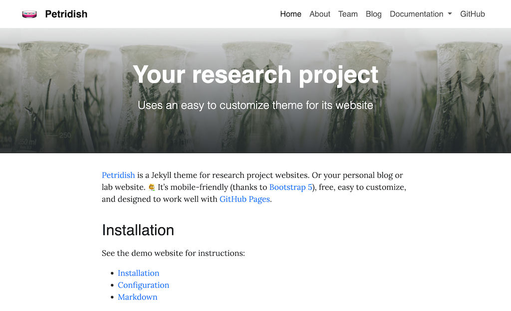

# APS - Agile Processor Specialization

The public APS website presents the framework, research areas, publications, release documentation, and tutorials.

## Release documentation

The public `/docs/` section is an APS software release guide: installation,
instruction finding, hardware synthesis, software compilation, and processor integration. Document each tool's purpose, capabilities, inputs, outputs, configuration, and
limitations before presenting example commands; these are toolchain references,
not a repeat of the tutorial. Give ScaleISA a dedicated guide. Its pages live in `pages/docs/`; the shared navigation is
`_includes/documentation-nav.html`. Use website links between guides and verify
commands against the APS source checkout. Do not expose repository `docs/` links.

## Updating APS content

Keep capability descriptions in `pages/home.md` and `_research/` aligned with the
[APS repository](https://github.com/pku-liang/aps-mlir).
Public website content should link to the repository or examples rather than files under `docs/`.
The four research areas are Custom Instruction Finding, Novel Hardware Description
Language, High-level Synthesis, and Processor Specialization, in that order. Each
uses one narrative paragraph discussing its relevant papers, without body
subheadings or a repeated lead summary. Application examples belong within these
areas. Base each paper description on its abstract, using at most one sentence per
work, then briefly connect the works to APS's goal. Custom Instruction Finding includes only
ISAMORE and ScaleISA, including its related-publication list. Keep card summaries concise.
People may specify `publication_name` when their published author name differs from
their profile name; publication links and profile publication lists use this field.
The ecosystem figure in `assets/images/overview.jpg` comes from the APS repository's
`assets/images/overview.jpg`. Update news and publication data only for confirmed
announcements. Publication code links should point to the implementation and
branch for that paper: ScaleISA uses `APS-MLIR/tree/main/scaleisa`, Aquas uses
`APS-MLIR`, the original APS uses `APS/tree/iccad25`, and both Cement and Cement2
link to the `Cement` repository's `cmt2` branch. Distinguish model estimates, accelerator cycles, and full processor
measurements when describing evaluation results.

Run `pixi run setup` for a new checkout, then `pixi run build` to validate content.
The build task exits on Jekyll failures so validation cannot silently pass.
Inspect the generated pages under `_site/`; use `pixi run serve` for a local preview.
Pushing to `main` triggers `.github/workflows/jekyll.yml` to build and deploy to
GitHub Pages. The workflow pins Ubuntu 24.04 and Ruby 3.3 to avoid changes
when GitHub moves the `ubuntu-latest` label; it uses the maintained
`ruby/setup-ruby@v1` action. Local edits and commits do not publish the site.

  
Website building: Jekyll/Petridish 

## Installation

See the demo website for instructions:

- [Installation](https://peterdesmet.com/petridish/docs/installation)
- [Configuration](https://peterdesmet.com/petridish/docs/configuration)
- [Markdown](https://peterdesmet.com/petridish/docs/markdown)

## Preview

[Demo website](https://peterdesmet.com/petridish)

## Contributing

Bug reports and pull requests are welcome on GitHub at https://github.com/peterdesmet/petridish. This project is intended to be a safe, welcoming space for collaboration, and contributors are expected to adhere to the [Contributor Covenant](http://contributor-covenant.org) code of conduct.

## License

[MIT License](LICENSE)

---

<!-- All the above is about the Petridish theme, so you might want to remove that. -->

_The instructions below can be adapted/included in the README of your site repository._

## Usage

This website makes use of the static website generator [Jekyll](https://jekyllrb.com/) and the [Petridish](https://github.com/peterdesmet/petridish) theme. **Each commit to `main` will automatically trigger a new build on GitHub Pages.** There is no need to build the site locally, but you can by installing Jekyll and running `bundle exec jekyll serve`.

Minor changes can be committed directly to `main`.

Changes requiring review (e.g. new blog posts) should be created in a separate branch and submitted as a pull request. Some guidelines:

- Use `72dpi` as image resolution
- Place background images in `assets/backgrounds/`, name them after their corresponding page/post and ideally crop them to `2100 x 700px`
- Place content images in `assets/images/`, name them after their corresponding page/post + a suffix, e.g. `-figure-1`
- Add tags to posts to create relevant groups (e.g. same topic, project).
- Create internal links as `[previous post]({{ '/permalink/to/post/' | relative_url }})`

## Repo structure

The repository structure follows that of Jekyll websites.

- General site settings: [_config.yml](_config.yml)
- Pages: [pages/](pages/)
- Posts: [_posts/](_posts/)
- Images & static files: [assets/](assets/)
- Top navigation: [_data/navigation.yml](_data/navigation.yml)
- Footer content: [_data/footer.yml](_data/footer.yml)
- Team members: [_data/team.yml](_data/team.yml)

## Paper figures

Website figures under `assets/images/papers/` are SVG exports of the supplied
paper PDFs, preserving the original diagrams. No LaTeX sources or submission
archives are published. Use descriptive alt text and no visible figure captions. Use relevant diagrams where they clarify the tools; the installation page has no figure. Use `documentation-figure.html` to center figures
at 70% of the content width (90% on small screens), with links to full-size assets.

| Website asset | Paper source |
| --- | --- |
| `isamore-motivation.svg` | ISAMORE, `fig/motivate-p1.pdf` |
| `scaleisa-overview.svg` | ScaleISA, `fig/overview_new-p1.pdf` |
| `aps-memory-interfaces.svg` | Aquas, `figures/interface-limitation-p1.pdf` |
| `aps-memory-schedule.svg` | Aquas, `figures/sequence-p1.pdf` |
| `aps-compiler.svg` | Aquas, `figures/compiler-final-p1.pdf` |

Keep figure discussion grounded in the accompanying paper; distinguish the
paper's concepts from command-line support in the current software release.

The overview uses the current APS ecosystem figure.
